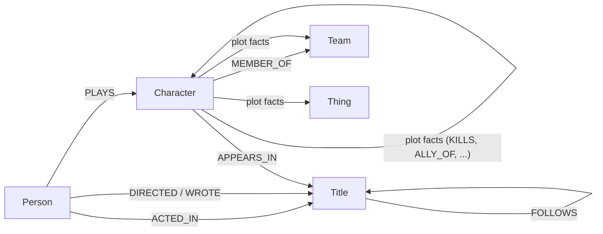

# The knowledge graph: nodes, relationships and where they come from

This explains what is in the Neo4j graph, for the MCU expert and for anyone reading or querying
it. The first part is plain language; the reference tables after it list every property.
The graph is rebuilt from the collected data by `src/graph/load_neo4j.py`; counts below are
from the build of 2026-11-20 and change when data is added.

## In plain words

The graph is a network of **things** (nodes) joined by **facts** (relationships, the arrows).

- A **Title** is a film or a series (or one season of a series, such as Loki season 1).
- A **Character** is one character *in one reality*. Peggy Carter of the main MCU (Earth-616),
  Captain Carter of Earth-838 and the What If...? Captain Carter are three Character nodes,
  joined by VARIANT_OF arrows. This is how the graph answers "is X the same as Y?".
- A **Person** is a real person: an actor, director or writer. Jon Favreau is one Person who
  both directs (Iron Man) and acts (Happy Hogan).
- A **Team** is a team or an organization from the curated teams list: the Avengers, the
  New Avengers (Thunderbolts), the Fantastic Four of Earth-828, S.H.I.E.L.D., the TVA, ...
- A **Thing** is anything else a plot fact mentions that is not in our tables: an object
  (the Tesseract, the TemPad), a place (the Quantum Realm), a group not in the teams list
  (the Ravagers), or a character we have no Character node for in that reality.

Facts come in two kinds:

1. **Facts from the data sources** (Wikidata, TMDB, the MCU wiki, the Marvel Database):
   who plays whom, who appears in what, who directed what, team memberships, variants,
   release dates, box office, ratings.
2. **Facts from the plot summaries** (extracted by AI agents from Wikipedia's plot and
   episode summaries): who fights, helps, kills, rescues, joins or loves whom. Every one of
   them keeps the **exact sentence** it came from (`evidence`), the title, and the episode,
   so it can be checked.

Example: *"Sylvie kills He Who Remains"* is a KILLS arrow from the Sylvie node to the
He Who Remains node, with `title_qid` = Loki season 1, `episode` = 6, and the summary sentence
as evidence.

## The picture



## How identities work

- **Titles** are identified by their Wikidata ID (`qid`), e.g. `Q192724` = Iron Man.
- **Characters** are identified by `<identity>@<reality>`:
  - the identity is the character's Wikidata ID (`Q24027972` = Daisy Johnson), or, for
    characters Wikidata does not have, their MCU wiki page (`mcuwiki:He_Who_Remains`);
  - the reality is an Earth number (`Earth-616` = the main MCU, `Earth-10005` = the Fox
    X-Men films, `Earth-838` = Multiverse of Madness's Illuminati universe, ...),
    `Multiverse` for What If...?, or `Unknown` for an unnumbered universe (Deadpool &
    Wolverine's Wolverine and Gambit).
  - So `Q24046118@Earth-616` (the MCU Loki) and `Q24046118@Multiverse` (What If...?'s Loki)
    are two characters sharing one identity, and are linked as variants.
- **People** are identified by their Wikidata ID, or `tmdb:<id>` when Wikidata has none.
- **Teams** are `<name>@<reality>`, e.g. `X-Men@Earth-10005` and `X-Men@Earth-92131`
  (X-Men '97) are different teams.
- **Things** are `<type>:<name>@<reality>`, e.g. `object:tesseract@Earth-616`: one node per
  name per reality (a leading "the" is ignored), shared by every fact that mentions it.

The realities, team list, curated roles and other expert decisions are in
[data_sources_and_tiers.md](data_sources_and_tiers.md).

## Nodes

| Label | Count | What it is | Key |
| --- | --- | --- | --- |
| Title | 98 | A film, series or season (Tiers 1 to 3) | `qid` |
| Character | 2,511 | A character in one reality | `id` |
| Person | 7,599 | An actor, director or writer | `key` |
| Team | 12 | A team or organization from the curated list | `id` |
| Thing | 691 | A plot-fact end that is not a character, team or title | `key` |
| Summary | 534 | A written summary of a title, season, character, team or group (src.graph.load_summaries) | `id` |
| Passage | 738 | A piece of a title's plot, for search (src.retrieval.indexes) | `id` |

Each key is unique (a Neo4j constraint). `(:Summary)-[:SUMMARIZES]->` its Title, Character or
Team, `(:Summary)-[:PART_OF]->(:Summary)` its group, and `(:Passage)-[:FROM]->(:Title)`; see
docs/rag_design.md ("Summary nodes", "Index set") for these and the search indexes.

### Title

| Property | Meaning | Source |
| --- | --- | --- |
| `qid`, `title`, `type`, `year` | Wikidata ID, name, Film / Series / Series season / Animated series, release year | title registry |
| `universe`, `reality`, `tier` | MCU, Fox X-Men, Netflix, ...; its Earth; collection tier | curated tier lists |
| `first_release_date` | Earliest release of any kind, premieres included | Wikidata and TMDB, or the verified table |
| `release_order` | Position by first release (1 = earliest) | derived |
| `chronological_order` | Position in the in-universe timeline | Disney+ order, then MCU wiki |
| `start_year`, `end_year`, `years_source` | In-universe years (negative = BC); `mcu_wiki` or `wikipedia` | MCU wiki, else Wikipedia |
| `phases`, `sagas` | MCU phases and sagas (empty outside the MCU phases) | Wikipedia and Wikidata |
| `box_office_usd`, `budget_usd` (+ `_source`) | US dollars; `wikidata`, or `tmdb` where Wikidata has none | Wikidata, TMDB |
| `runtime_minutes` | Running time | Wikidata, else TMDB |
| `tmdb_rating`, `tmdb_votes` | TMDB average vote and vote count (they drift daily) | TMDB |

### Character

| Property | Meaning | Source |
| --- | --- | --- |
| `id`, `base_qid`, `reality` | See "How identities work" | derived |
| `label` | Display name | Wikidata, MCU wiki or curated |
| `aliases` | Other names (Scarlet Witch, Skye, ...) | Wikidata, MCU wiki, Marvel Database, TMDB credits |
| `species` | From the MCU wiki infobox (Inhuman, Asgardian, Human, Kree, ...) | MCU wiki |
| `identity_source` | `wikidata` or `mcu_wiki` | derived |
| `cameo` | True when every credit for the character is a cameo (Stan Lee's "Watcher Informant" and his other cameo roles) | derived |
| `marvel_db_page`, `mcu_wiki_page` | The character's page on each wiki | Wikidata, matching |

### Person

| Property | Meaning | Source |
| --- | --- | --- |
| `key`, `qid`, `tmdb_id`, `name` | Wikidata ID (or `tmdb:<id>`), TMDB ID, name | Wikidata, TMDB |
| `birth_date` | Wikidata's when it gives one date, else TMDB's | Wikidata, TMDB |

### Team

| Property | Meaning | Source |
| --- | --- | --- |
| `id`, `name`, `reality` | See "How identities work" | curated teams list |
| `kind` | `team` (Avengers, Defenders) or `organization` (S.H.I.E.L.D., HYDRA, the Hand, TVA) | curated (expert) |
| `aliases` | Other names (Thunderbolts for the New Avengers, TVA, ...) | curated, wikis |

### Thing

| Property | Meaning |
| --- | --- |
| `key`, `name`, `reality` | See "How identities work"; `name` is as the plot fact gave it |
| `type` | `character` (277), `object` (178), `organization` (109), `place` (79), `team` (18), `universe` (12), `event` (12), `time` (6) |

`character` is also the type of every fact's subject, so a name the plot facts call
`character` once and, say, `organization` elsewhere is one `organization` Thing (the
Ravagers). A name given two other types keeps one Thing per type (the Ten Rings as an
organization and as an object).

## Relationships from the data sources

| Relationship | From → To | Count | Meaning | Properties |
| --- | --- | --- | --- | --- |
| APPEARS_IN | Character → Title | 3,285 | The character is in the title | |
| PLAYS | Person → Character | 3,407 | The person plays the character (one arrow per title) | `title_qid`, `credited_as` (TMDB credit text), `billing_order` (0 = top-billed), `cameo` |
| ACTED_IN | Person → Title | 8,889 | Every acting credit, also those not linked to a character (most of Stan Lee's cameos) | `cameo` |
| DIRECTED, WROTE | Person → Title | 112, 205 | Director, screenwriter | |
| FOLLOWS | Title → Title | 38 | The title follows the other in its own film or TV series (Iron Man 2 → Iron Man; Loki season 2 → season 1). Release order in the MCU, its phases or the Netflix series is not a sequel and is not used | |
| VARIANT_OF | Character → Character | 197 | Two versions of one character in different realities (shared Wikidata identity, "based on" item, or curated "variant of") | `shared_qid` |
| MEMBER_OF | Character → Team | 455 | Membership from the MCU wiki and Marvel Database team pages | `role` (member, leader, founder), `status` (current, former), `source`, `source_url` |

## Relationships from the plot summaries

One arrow per extracted fact: 3,552 facts from all 98 titles. Each has `title_qid`, `episode`
(series only, numbered across the whole series), `evidence` (the exact quote), `note` (the
agent's remark, e.g. "undone later"), `chunk` (which piece of text it came from) and
`source = 'plot'`. A plot fact may join a Character, a Team or a Thing at either end.

| Relationship | Count | Meaning |
| --- | --- | --- |
| ENEMY_OF | 845 | opposes, fights against, hunts |
| ALLY_OF | 552 | works with, helps, fights alongside |
| KILLS | 430 | kills (also when undone later; see `note`) |
| RESCUES | 413 | saves, frees, resurrects |
| FAMILY_OF | 267 | parent, child, sibling, spouse (the kind is in `note`) |
| POSSESSES | 187 | has, steals, uses or is given an object |
| WORKS_FOR | 183 | is employed by, serves, obeys |
| MEMBER_OF | 154 | belongs to a team or organization (as told in the plot) |
| LEADS | 139 | leads a team, organization or group |
| TRAVELS_TO | 114 | goes to a place, time or universe |
| ROMANCE_WITH | 113 | a romantic relationship |
| CREATES | 107 | builds, founds or causes something |
| IMPERSONATES | 35 | poses as someone else |
| VARIANT_OF | 13 | the plot says one is another version of the other |

MEMBER_OF and VARIANT_OF exist from both kinds of source; `source = 'plot'` tells them apart.

The extraction agents give an ID for each character or team they find in the title's cast and
team lists. A fact end the agent could only name is joined by name, within the title's reality:

1. a group (any subject, or an end typed team or organization) to the Team with that name;
2. else a character to the Character with that name: Natalie Rushman is Natasha Romanoff,
   the Power Broker is Sharon Carter, Thanos is Thanos where he is named but not in the cast.

A Character or Team's own name is tried first, then its aliases; the match must be the only
one (five characters are named Loki, so "Loki" without an ID stays a Thing). A name that would
join the fact's other end itself stays a Thing: a cover identity, a symbiote, a transformed
form ("Natasha impersonates Natalie Rushman"). 97 fact ends were joined by name (96 characters,
1 team); the rest stay Things.

How the plot facts were extracted, and the rules the agents followed, are in
[extraction_agents.md](extraction_agents.md) and
[../src/graph/extraction_prompt.md](../src/graph/extraction_prompt.md).

## Exploring it

In Neo4j Browser (http://localhost:7474, user `neo4j`, password in `.env`):

```cypher
// The schema itself: one node per label, one arrow per relationship type
CALL db.schema.visualization()

// One film and everything around it (The Avengers, 2012)
MATCH (t:Title {title: 'The Avengers'})
OPTIONAL MATCH (c:Character)-[a:APPEARS_IN]->(t)
OPTIONAL MATCH (p:Person)-[pl:PLAYS {title_qid: t.qid}]->(c)
OPTIONAL MATCH (x)-[f]->(y) WHERE f.title_qid = t.qid AND f.source = 'plot'
RETURN t, c, a, p, pl, x, f, y

// Every version of a character (Wolverine)
MATCH (w:Character {id: 'Q97275436@Earth-10005'})-[:VARIANT_OF*1..2]-(v:Character)
RETURN w, v

// The plot facts about one character, with their evidence
MATCH (c:Character {label: 'Thanos'})-[f]->(o) WHERE f.source = 'plot'
RETURN type(f) AS fact, coalesce(o.label, o.name) AS other, f.evidence AS evidence
```

The 50 evaluation questions and their Cypher are in `src/graph/evaluate.py`
(`.venv\Scripts\python.exe -m src.graph.evaluate`); the questions and expected answers are in
[evaluation_questions.md](evaluation_questions.md).

## Known limitations

- **Things are joined only by exact name.** 277 character Things have no single Character of
  that name in their reality: most have no Character node there (What If...?'s variants in
  the Multiverse reality, Peter Parker of Earth-86445), some share a name (Loki, Odin).
  Near-duplicates are not merged ("branched timelines" and "Branching timelines tree").
- **Joining by alias trusts the aliases.** A wrong alias joins a name to the wrong character.
  Known case, fix pending: Wikidata links T'Challa and Natasha Romanoff to the MCU wiki pages
  "Black Panther" and "Black Widow", which now describe Shuri and Yelena Belova, so both carry
  their successor's names as aliases.
- **Plot facts depend on the summaries.** A fact missing from Wikipedia's summary is missing
  from the graph (Heimdall's death is not among the Infinity War facts). Some series share one
  summary across several episodes (Agents of S.H.I.E.L.D., X-Men '97).
- **Cameos are marked for Stan Lee only** (user decision, 2026-11-27). Every acting credit of
  Stan Lee's is a cameo (`cameo` on PLAYS and ACTED_IN), and a character all of whose credits
  are cameos has `cameo: true` (his "Watcher Informant", 19 titles), so "most titles" counts can
  leave it out. Other actors' cameos are not marked: no source says which credits are cameos.
- **No comics.** Comics are out of scope for now (expert decision).
- **Ratings drift.** TMDB ratings change daily; the graph holds the values of the last
  collection.
